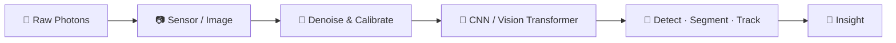

<div align="center">


<br>


</div>

---

# 🌸 MY SAKURA TREE

<div align="center">



<sub>🌸 A little sakura tree under a moonlit sky, **redrawn every night** by a GitHub Action.<br>
More commits → bigger tree &nbsp;·&nbsp; my languages → flower-centre colours &nbsp;·&nbsp; a streak → glowing fairy lights ✨<br>
a golden retriever puppy 🐶 guards the tree while a puppy-faced lantern floats by 🏮<br>
the soft pink box is a tiny "object detector" saying hi 👁️</sub>

</div>

---

# 👁️ SYSTEM PROFILE

```python
class SriyaMeenakshi:

    role = "AI & ML Undergraduate"

    identity = [
        "Computer Vision Learner",
        "Open Source Contributor",
        "Space Physics Admirer",
        "Hobbyist Photographer",
    ]

    interests = [
        "Computer Vision",
        "Astrophysics & Orbital Mechanics",
        "Satellite & Telescope Imagery",
        "Open Source",
        "Competitive Programming",
        "Arts and Crafts",
    ]

    mission = "See. Understand. Explore."
```

---

# 🚀 ABOUT ME

👁️ AI & ML undergraduate teaching machines to *see*

🔭 Fascinated by space, orbital mechanics, black holes and how we image the universe

📸 Hobbyist photographer, so I already think in frames, light and exposure

⚡ Open source contributor learning through building

🛰️ Dream project: computer vision on space imagery

---

# 🧪 VISION PIPELINE



```text
>> scanning frame ................ ok
>> objects detected .............. stars, craters, curious humans
>> confidence .................... 0.97
```

---

# ⚙️ TECH STACK

<div align="center">


<br><br>


<br><br>


</div>

---

# 🌠 OPEN SOURCE PROTOCOL

<div align="center">


</div>

```terminal
STATUS :: ACTIVE

MISSION ::
BUILD
LEARN
CONTRIBUTE
COLLABORATE
```

---

# 🛰️ MISSION ARCHIVE

| EVENT | ACHIEVEMENT |
|--------|-------------|
| 🏆 Google Solution Challenge 2025 | Top 105 Teams Globally |
| 🐄 Project Kamadhenu | AI + Impact |
| ⚕️ MedTech Hackathon | Project ArogyaDrishti |
| 🛣️ National Road Safety Hackathon | Project MAARG SETU |
| ❄️ Snowflake AI For Good | Inventory Heatmap + Stock Alert |

---

# 🌌 SPACE PHYSICS CORNER

```python
import math

G  = 6.674e-11        # gravitational constant
M  = 5.972e24         # mass of Earth (kg)
r  = 6.771e6          # ~400 km orbit (m)

v  = math.sqrt(G * M / r)             # orbital speed
T  = 2 * math.pi * math.sqrt(r**3 / (G * M))   # period

print(f"v = {v/1000:.2f} km/s,  one lap every {T/60:.0f} min")
# v = 7.67 km/s,  one lap every 92 min  -> the ISS sees ~16 sunrises a day
```

```diff
+ Orbital mechanics & gravity
+ Black holes, event horizons & gravitational lensing
+ Exoplanet transits: dips in starlight a camera can catch
+ Telescope imagery: where computer vision meets cosmology
```

---

# 💻 DEV WORKSTATION

```yaml
LANGUAGES:
  - C
  - C++
  - Python
  - Java
  - JavaScript
  - TypeScript

CURRENT_FOCUS:
  - Computer Vision
  - Open Source
  - AI & ML
  - Space x AI
```

---

# 📊 GITHUB TELEMETRY

<div align="center">


<br>


</div>

---

# 🌐 CONNECT

<div align="center">

<a href="https://www.linkedin.com/in/sriya-meenakshi-chalamalasetty">

</a>

<a href="https://github.com/SriyaMeenakshi">

</a>

<a href="mailto:chsriyameenu2818@gmail.com">

</a>

</div>

---

<div align="center">

> "We are a way for the cosmos to know itself."

— Carl Sagan

</div>


